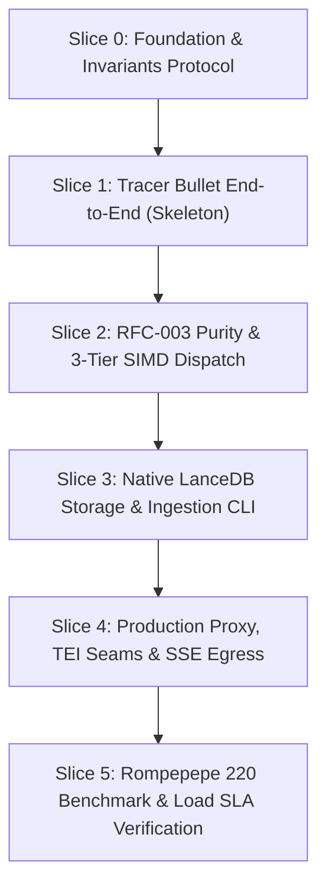

# ROADMAP EJECUTABLE DETERMINISTA: SEMANTIC FIREWALL CORE (sf-core)
## Protocolo: Transparent Dev Agent Protocol (Vertical Slices / Tracer Bullets)
## Estado de Grounding: 100% Desbloqueado con Matriz Ejecutiva del Arquitecto

---

### 1. REGLAS INNEGOCIABLES DE EJECUCIÓN PARA EL AGENTE DE IA

1. **Toolchain Canónico Único**:
   - Exclusivamente `cargo` gobernando el workspace Rust (`cargo check`, `cargo test`, `cargo clippy`, `cargo bench`, `cargo run`).
   - Cero mezclas de gestores. Cero scripts bash ad-hoc para compilar o testear.
2. **Desarrollo Guiado por Vertical Slices (Tracer Bullets)**:
   - Prohibido el slicing horizontal (implementar capas aisladas sin probar integración end-to-end).
   - Cada slice debe quedar en **VERDE** (`cargo test --workspace` y `cargo clippy --workspace --all-targets -- -D warnings`) antes de avanzar al siguiente slice.
3. **Pureza Numérica IEEE 754 (RFC-003)**:
   - Prohibido el redondeo decimal (`round()`, `:.4f`) y casteo a `f16`/`bf16`.
   - Almacenamiento en `f32` crudo; acumuladores de producto punto y normas en `f64`.
4. **Política de Memoria y Alineación**:
   - Los tensores en hot-path se manipulan en memoria alineada a 64 bytes (`AlignedVec1024`).
   - La ingesta desde Arrow valida finitud y copia hacia `AlignedVec1024` en el cold-path. Fail-closed ante `NaN`/`Inf` o dimensión $\neq 1024$.
5. **Higiene Documental Condicional**:
   - Modificar `manifest.json`, `CONTEXT.md` y `architecture_spec.md` **solo** cuando se alteran contratos, invariantes o términos de dominio.
   - Todo commit debe reportar el bloque final de Git metadata (`Branch Name`, `Commit Message`).

---

### 2. ARQUITECTURA DE CRATES Y DEPENDENCIAS DEL WORKSPACE

```
crates/
├── sf-kernels/     # Primitivas de memoria (AlignedVec1024), kernels SIMD (AVX-512, AVX2+FMA, NEON, Scalar), L1/L2/L3
├── sf-storage/     # Persistencia LanceDB, esquemas Arrow re-exportados, ArcSwap<DomainRegistry>, CLI sf-ingest
├── sf-proxy/       # Daemon Axum (/v1/chat/completions), segmentador de cláusulas, gRPC/HTTP embedders, SSE streaming
└── sf-bench/       # Generador de fixtures deterministas (ChaCha8), harness Rompepepe 220, test de carga 1,000 RPS
```

#### `Cargo.toml` Raíz (Versiones Homologadas por el Arquitecto)
```toml
[workspace]
resolver = "2"
members = [
    "crates/sf-kernels",
    "crates/sf-storage",
    "crates/sf-proxy",
    "crates/sf-bench",
]

[workspace.package]
version = "0.1.0"
edition = "2021"
rust-version = "1.82"
license = "Apache-2.0"

[workspace.dependencies]
# Storage & Columnar Engine (Arrow types re-exported via lancedb::arrow::*)
lancedb = { version = "0.40.0", default-features = false }
arrow-array = "58.0.0"
arrow-buffer = "58.0.0"
arrow-schema = "58.0.0"

# Async Runtime & HTTP/gRPC Proxy
tokio = { version = "1.43.0", features = ["rt-multi-thread", "macros", "net", "time", "sync", "signal"] }
tokio-stream = "0.1.17"
axum = { version = "0.8.1", features = ["http1", "http2", "json"] }
reqwest = { version = "0.12.12", default-features = false, features = ["json", "stream", "http2", "rustls-tls"] }
tonic = { version = "0.12.3", features = ["transport", "prost"] }
prost = "0.13.4"
bytes = "1.10.0"
futures-util = "0.3.31"
async-trait = "0.1.86"

# Concurrency, Crypto & Serialization
arc-swap = "1.7.1"
serde = { version = "1.0.217", features = ["derive"] }
serde_json = "1.0.138"
sha2 = "0.10.8"

# Benchmarking & Deterministic RNG
criterion = { version = "0.5.1", features = ["html_reports"] }
hdrhistogram = "7.5.4"
rand = "0.8.5"
rand_chacha = "0.3.1"

[profile.release]
opt-level = 3
lto = "fat"
codegen-units = 1
panic = "abort"
strip = "symbols"
```

---

### 3. FASES DE IMPLEMENTACIÓN (VERTICAL SLICES)



---

#### SLICE 0: Workspace Bootstrap & Invariants Protocol
**Objetivo**: Inicializar el árbol de crates, configuración del compilador y assets de documentación según el protocolo.

* **Tarea S0-01: Estructura del Workspace y Toolchain**
  * Crear `Cargo.toml` raíz con las dependencias fijadas y `rust-toolchain.toml` fijando canal `1.82`.
  * Crear esqueletos de crates: `crates/sf-kernels/Cargo.toml`, `crates/sf-storage/Cargo.toml`, `crates/sf-proxy/Cargo.toml`, `crates/sf-bench/Cargo.toml`.
  * Configurar `.gitignore` (ignorando `/target`, `.env`, datos binarios grandes) y `.env.example`.
  * Copiar `.agents/skills/transparent-dev-protocol/templates/.pre-commit-config.yaml` a `.pre-commit-config.yaml`.
  * *Verificación*: `cargo check --workspace` compila en verde.

* **Tarea S0-02: Bootstrap Documental del Protocolo**
  * Crear `manifest.json`:
    ```json
    {
      "project": "sf-core",
      "version": "0.1.0",
      "state_schema": {
        "vector_dim": 1024,
        "default_quorum_k": 103,
        "alignment_bytes": 64
      },
      "constraints": {
        "p99_latency_ms": 2.0,
        "max_concurrency_rps": 1000,
        "max_rss_mb": 45
      }
    }
    ```
  * Crear `CONTEXT.md` definiendo términos canónicos: `DomainHypercubeLock`, `AlignedVec1024`, `NoiseBitmask1024`, `SpectralQuorum`, `UniversalNoiseIndices`, `ClauseSegmenter`.
  * Crear `architecture_spec.md` registrando los ADRs (ADR-001 a ADR-004) y las 8 decisiones de arquitectura homologadas.
  * *Verificación*: `git status` limpio con archivos requeridos.

---

#### SLICE 1: Tracer Bullet End-to-End (Ingress-to-Decision Skeleton)
**Objetivo**: Construir el flujo vertical mínimo completo ejecutable: prompt $\to$ segmentador $\to$ evaluación L1/L2/L3 (escalar) $\to$ proxy HTTP fail-closed.

* **Tarea S1-01: Primitivas de Memoria y Kernel Escalar**
  * **Archivo**: `crates/sf-kernels/src/lib.rs`, `crates/sf-kernels/src/types.rs`, `crates/sf-kernels/src/scalar.rs`.
  * **Implementación**:
    1. `AlignedVec1024` con layout `#[repr(C, align(64))]` y comprobaciones estáticas de tamaño (`4096 B`) y alineación (`64 B`).
    2. `NoiseBitmask1024` con `new_bge_m3_default()` apagando los 9 índices universales: `[292, 297, 308, 329, 386, 404, 577, 616, 780]` (dejando 1015 dimensiones activas).
    3. `DomainHypercubeLock` pre-dilatado con `lo_dilated = lo - eps` y `hi_dilated = hi + eps`.
    4. `scalar_cosine_similarity` acumulado en `f64` con `mul_add`.
    5. `evaluate_l3_gate` en modo escalar para `ModeATopK`, `ModeBStrictHypercube` y `ModeCSpectralQuorum` ($K=103$).
  * *Test Unitario*: `crates/sf-kernels/tests/scalar_eval_test.rs` verificando que un vector que cumple quórum pasa y uno que no cumple falla con `failing_coordinates`.
  * *Verificación*: `cargo test -p sf-kernels --test scalar_eval_test`

* **Tarea S1-02: Segmentador Básico, Registro en Memoria y Handler Axum**
  * **Archivo**: `crates/sf-storage/src/mem_registry.rs`, `crates/sf-proxy/src/segmenter.rs`, `crates/sf-proxy/src/lib.rs`.
  * **Implementación**:
    1. `segment_prompt_clauses` inicial separando por saltos de línea y puntuación.
    2. Trait `BatchEmbedderClient` con `MockBatchEmbedder` para pruebas en memoria.
    3. Trait `UpstreamLlmForwarder` con `MockUpstreamForwarder` devolviendo `200 OK`.
    4. Handler Axum `POST /v1/chat/completions` orquestando la cascada L1 $\to$ L2 $\to$ L3.
    5. Retorno de `X-SF-Decision: PASS` o `403 Forbidden` (`SEMANTIC_CONTAINMENT_BREACH`).
  * *Test de Integración*: `crates/sf-proxy/tests/tracer_bullet_e2e.rs` realizando requests HTTP vía `tower::ServiceExt` y verificando `200 OK` para prompts válidos y `403 Forbidden` ante brechas semánticas.
  * *Verificación*: `cargo test -p sf-proxy --test tracer_bullet_e2e`

---

#### SLICE 2: RFC-003 Numerical Purity & 3-Tier SIMD Dispatch
**Objetivo**: Implementar aceleración SIMD en 3 niveles (`AVX-512` $\to$ `AVX2+FMA` $\to$ `NEON`/`Scalar`) garantizando bit-exactitud estricta bajo IEEE 754.

* **Tarea S2-01: Kernels Intrínsecos SIMD y Dispatch Dinámico**
  * **Archivo**: `crates/sf-kernels/src/simd/mod.rs`, `avx512.rs`, `avx2.rs`, `neon.rs`.
  * **Implementación**:
    1. `avx512`: registros `zmm` (512-bit), `_mm512_cvtps_pd` + `_mm512_fmadd_pd`, máscaras `_mm512_cmp_ps_mask`.
    2. `avx2`: registros `ymm` (256-bit), `_mm256_fmadd_pd` acumulando en `f64`, comparaciones `_mm256_cmp_ps` y extracción de bits vía `_mm256_movemask_ps`.
    3. `neon`: registros `float32x4_t`, conversión a `f64` (`vcvt_f64_f32`), `vcgeq_f32`, `vcleq_f32`, empaquetado de bits y reducción `vaddvq_u32`.
    4. Función de despacho dinámico:
       ```rust
       #[inline]
       pub fn dispatch_cosine_1024(q: &AlignedVec1024, c: &AlignedVec1024) -> f32;
       #[inline]
       pub fn dispatch_hypercube_bitmask(q: &AlignedVec1024, lock: &DomainHypercubeLock) -> [u64; 16];
       ```
  * *Fuzzing Test*: `crates/sf-kernels/tests/simd_parity_fuzz.rs` comparando 10,000 vectores pseudoaleatorios (incluyendo subnormales) evaluados en SIMD vs. Escalar: aserción de bit-exactitud (`assert_eq!(simd_bits, scalar_bits)`).
  * *Verificación*: `cargo test -p sf-kernels --test simd_parity_fuzz`

* **Tarea S2-02: Suite de Regresión Micro-Gap RFC-003 y Microbenchmarks**
  * **Archivo**: `crates/sf-kernels/tests/rfc003_purity.rs`, `crates/sf-kernels/benches/kernel_bench.rs`.
  * **Implementación**:
    1. Construir límites $[lo_d, hi_d]$ y vectores adversariales separados por $\Delta = 1.5 \times 10^{-6}$ ($16\text{ ULP}$) en 920 coordenadas.
    2. Demostrar que el kernel puro rechaza el $100\%$ de los vectores (0 votos afirmativos), mientras que el redondeo decimal `round(x, 4)` o casteo a `f16` colapsa la micro-brecha y genera falsos positivos.
    3. Microbenchmarks con Criterion: verificar latencia $< 250\text{ ns}$ para coseno y $< 300\text{ ns}$ para evaluación L3.
  * *Verificación*: `cargo test -p sf-kernels --test rfc003_purity && cargo bench -p sf-kernels`

---

#### SLICE 3: Native LanceDB Storage & Ingestion CLI
**Objetivo**: Persistencia nativa en LanceDB con re-export de Arrow, validación de finitud, copy-on-load a `AlignedVec1024` y CLI determinista `sf-ingest`.

* **Tarea S3-01: Esquema Arrow y Carga Atómica con ArcSwap**
  * **Archivo**: `crates/sf-storage/src/schema.rs`, `crates/sf-storage/src/registry.rs`, `crates/sf-storage/src/lib.rs`.
  * **Implementación**:
    1. Esquema Arrow con `FixedSizeList(Float32, 1024)` para vectores y `FixedSizeBinary(128)` para la máscara de ruido.
    2. Importar tipos Arrow exclusivamente vía `lancedb::arrow::{arrow_array, arrow_buffer, arrow_schema}`.
    3. Implementar `load_validated_vec1024`:
       - Rechaza `NaN`/`Inf` con `fail-closed`.
       - Comprueba alineación: si `ptr % 64 != 0`, incrementa el contador atómico `UNALIGNED_ARROW_BUFFER_LOADS`.
       - Copia hacia `AlignedVec1024` en stack/heap con pre-dilatación $\pm\epsilon$.
    4. Envolver `DomainRegistry` en `arc_swap::ArcSwap<DomainRegistry>` para lectura libre de locks en caliente.
  * *Test de Concurrencia*: `crates/sf-storage/tests/registry_concurrent_test.rs` ejecutando 32 hilos lectores continuos mientras un hilo actualiza la versión del registro vía `ArcSwap::store`: aserción de 0 panics y 0 lecturas bloqueadas.
  * *Verificación*: `cargo test -p sf-storage --test registry_concurrent_test`

* **Tarea S3-02: Calibración con Poda Paramétrica y CLI `sf-ingest`**
  * **Archivo**: `crates/sf-storage/src/calibration.rs`, `crates/sf-storage/src/bin/sf_ingest.rs`.
  * **Implementación**:
    1. Función `calibrate_noise_bitmask`:
       - Inicia con las 9 coordenadas universales desactivadas (1015 activas).
       - Soporta `--extra-pruned-dims <N>` (ej. 30 para replicar 985 dimensiones) podando las $N$ dimensiones con menor estabilidad SNR $S_d = |\mu_d| / (hi_d - lo_d + \epsilon_{\text{mach}})$.
    2. CLI `sf-ingest` con `clap`: extrae envolventes $[lo_d, hi_d]$, calcula centroides en `f64`, genera digest SHA-256 sobre el buffer binario crudo y persiste el `RecordBatch` en LanceDB.
  * *Test Round-Trip*: `crates/sf-storage/tests/ingestion_roundtrip_test.rs` ingiriendo 500 vectores sintéticos en LanceDB, cargándolos en `DomainRegistry` y confirmando identidad binaria estricta de coordenadas (`lo_read.to_bits() == lo_expected.to_bits()`).
  * *Verificación*: `cargo test -p sf-storage --test ingestion_roundtrip_test`

---

#### SLICE 4: Production Proxy, TEI Seams & SSE Egress
**Objetivo**: Integrar gRPC/HTTP contra HuggingFace TEI con normalización $L_2$ estricta, segmentador robusto, enrutamiento multidominio y streaming SSE passthrough.

* **Tarea S4-01: Segmentador de Cláusulas Endurecido**
  * **Archivo**: `crates/sf-proxy/src/segmenter.rs`.
  * **Implementación**:
    1. Splitter de un solo paso en $O(L)$ sobre slices de `&str` (cero alocaciones dinámicas de string).
    2. Delimitadores de comentarios y docstrings (`"""`, `'''`, `/*`, `*/`, `//`, `#`), saltos de línea y signos de puntuación.
    3. Ventana deslizante para segmentos con $> 20$ palabras ($W=20, S=10$).
  * *Test de Piggybacking*: `crates/sf-proxy/tests/segmenter_piggybacking_test.rs` aislando inyecciones dentro de docstrings de Python en $< 2\ \mu\text{s}$.
  * *Verificación*: `cargo test -p sf-proxy --test segmenter_piggybacking_test`

* **Tarea S4-02: Adapters de Inferencia TEI (gRPC + HTTP) con Invariante de Normalización**
  * **Archivo**: `crates/sf-proxy/proto/tei.proto`, `crates/sf-proxy/build.rs`, `crates/sf-proxy/src/embedder.rs`.
  * **Implementación**:
    1. Compilar `proto/tei.proto` vía `tonic-build` / `prost-build`.
    2. `TeiGrpcEmbedder`: invoca `EmbedStream` forzando `normalize: Some(true)` en cada request (regla crítica del arquitecto).
    3. `TeiHttpEmbedder`: invoca `/embed` vía `reqwest`.
    4. Validación común: `validate_and_normalize_f32_slice` acumulada en `f64`, rechazando `NaN`/`Inf` y forzando norma $L_2 = 1.0$.
  * *Test Unitario*: `crates/sf-proxy/tests/embedder_normalization_test.rs` comprobando que vectores sin normalizar son corregidos a norma unitaria exacta y vectores con `NaN` son rechazados fail-closed.
  * *Verificación*: `cargo test -p sf-proxy --test embedder_normalization_test`

* **Tarea S4-03: Enrutamiento Multidominio (`X-Semantic-Domain`), Telemetría y Egress Passthrough**
  * **Archivo**: `crates/sf-proxy/src/routing.rs`, `crates/sf-proxy/src/upstream.rs`, `crates/sf-proxy/src/telemetry.rs`, `crates/sf-proxy/src/lib.rs`.
  * **Implementación**:
    1. Enrutador:
       - Denylists (`polarity == 1`): intersección estricta (todas deben pasar).
       - `X-Semantic-Domain: *`: política `AnyAllowlist` por defecto (unión consistente: al menos un lock de allowlist debe contener el prompt y todas sus cláusulas) o `AllLocks` vía header `X-SF-Wildcard-Mode: all`.
    2. Upstream forwarder: streaming directo `axum::body::Body::from_stream(upstream_resp.bytes_stream())` con $0\text{ ms}$ de penalización en TTFT.
    3. Telemetría de fallo cerrado `403 Forbidden` (`SEMANTIC_CONTAINMENT_BREACH`) reportando bits exactos en hexadecimal, delta out-of-bounds y SHA-256 de la cláusula.
  * *Test de Integración*: `crates/sf-proxy/tests/cascade_e2e_test.rs` validando denylists globales, wildcard allowlists y streaming passthrough.
  * *Verificación*: `cargo test -p sf-proxy --test cascade_e2e_test`

---

#### SLICE 5: Rompepepe 220 Benchmark & Load SLA Verification
**Objetivo**: Reproducción determinista del 100% de contención en Rompepepe y certificación de latencia p99 $< 2.0\text{ ms}$ a 1.000 RPS.

* **Tarea S5-01: Generador de Fixtures Determinista y Script NPZ**
  * **Archivo**: `crates/sf-bench/src/synthetic_fixtures.rs`, `tools/export_ddi_npz_to_lance.py`.
  * **Implementación**:
    1. `synthetic_fixtures.rs`: generador determinista con `ChaCha8Rng` (semilla `0xDD10_0400`) que produce los 55 locks canónicos ($\binom{11}{2}$) y los 220 vectores de prueba en memoria sin requerir red ni Git LFS.
    2. `tools/export_ddi_npz_to_lance.py`: script Python puente para importar matrices reales de `ddi_fw/out/rows.npz` directamente hacia tablas LanceDB.
  * *Verificación*: `cargo test -p sf-bench --test fixtures_generation_test`

* **Tarea S5-02: Harness de Evaluación Rompepepe**
  * **Archivo**: `crates/sf-bench/src/bin/rompepepe_eval.rs`.
  * **Implementación**:
    1. Ejecutar matriz comparativa de 4 vías: (1) Coseno Escalar, (2) L3 Modo A, (3) L3 Modo B, (4) L3 Modo C.
    2. Validar que Coseno Escalar filtra entre $14.5\%$ y $58.2\%$.
    3. Validar que **L3 Modo C alcanza 100% de contención (220/220 bloqueados)**.
    4. Exportar reporte en `reports/rompepepe_v3_matrix.json`.
  * *Comando de Verificación*: `cargo run --release -p sf-bench --bin rompepepe_eval`

* **Tarea S5-03: Benchmark de Carga a 1.000 RPS y Certificación de SLA**
  * **Archivo**: `crates/sf-bench/src/bin/load_benchmark.rs`.
  * **Implementación**:
    1. Generador de carga asíncrono (`tokio` + `hdrhistogram`) atacando `/v1/chat/completions` con $M=16$ cláusulas a 1.000 RPS durante 60 segundos sostenidos.
    2. Medir exclusivamente el overhead del gateway (L1 + L2 + L3).
    3. Aserciones de SLA:
       - $\text{p99} < 1.5\text{ ms}$ (SLA $< 2.0\text{ ms}$).
       - $\text{p50} < 0.15\text{ ms}$ ($150\ \mu\text{s}$).
       - Huella de memoria RSS $< 45\text{ MB}$.
  * *Comando de Verificación*:
    ```bash
    cargo run --release -p sf-bench --bin load_benchmark -- --rps 1000 --duration-secs 60 --assert-p99-ms 2.0
    ```

---

### 4. MATRIZ DE VERIFICACIÓN Y DEFINITION OF DONE (DoD)

Para declarar finalizado el desarrollo del core y autorizar la entrega al usuario bajo el Approval Gate (`transparent-dev-protocol` §3.1), se deben satisfacer todas las siguientes condiciones:

| Invariante / Requisito | Comando Canónico de Verificación | Criterio de Éxito |
| :--- | :--- | :--- |
| **Higiene de Formato** | `cargo fmt --all -- --check` | 0 líneas desformateadas |
| **Linting Estricto** | `cargo clippy --workspace --all-targets -- -D warnings` | 0 warnings |
| **Paridad y Pureza SIMD** | `cargo test -p sf-kernels --test simd_parity_fuzz` | 10.000 vectores con 0 ULP delta |
| **Regresión RFC-003** | `cargo test -p sf-kernels --test rfc003_purity` | 100% de rechazo en micro-gap |
| **Suite Completa de Tests** | `cargo test --workspace` | Todos los tests unitarios y de integración en VERDE |
| **Contención Rompepepe** | `cargo run --release -p sf-bench --bin rompepepe_eval` | **220 / 220 vectores contenidos (100%)** |
| **Latencia p99 y SLA** | `cargo run --release -p sf-bench --bin load_benchmark` | **$\text{p99} < 1.50\text{ ms}$ a 1.000 RPS, RSS $< 45\text{ MB}$** |
| **Sincronización Documental** | Auditoría de `manifest.json`, `CONTEXT.md`, `CHANGELOG.md` | Estado sincronizado con el código real |
